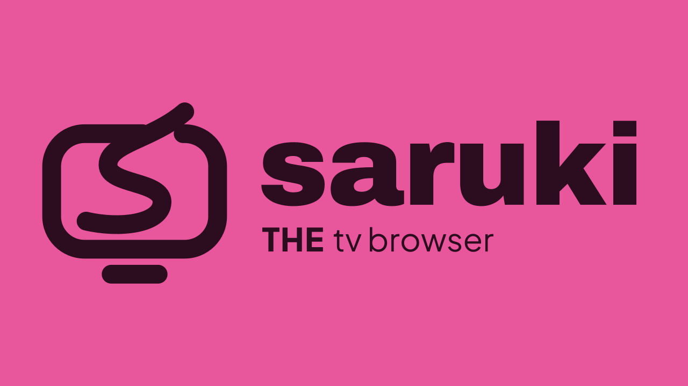

# Saruki: THE tv browser



Saruki is a web browser made for Android TV and Google TV, built to be driven from the couch. It comes with
**Saruki Remote**, a phone app that turns your phone into a trackpad, a keyboard and a webcam for the browser.

## Saruki on the TV

- **A real pointer.** Arrows glide a pointer that grows over links and shrinks over text boxes. Push past the edge of
  the screen to scroll whatever is under it, including boxes inside the page.
- **Top bar.** Back, Forward, Stop, Reload and the address are always one click away above the page.
- **Plays everything.** Any video on a page can open in the built-in TV Player (MP4, MKV, AVI, HLS, DASH, with FFmpeg
  audio decoders for AC3 / DTS and more).
- **Pop-up and redirect shield.** Only a click on a real, visible link may open a tab, send the page somewhere else or
  open another app. Built for the streaming sites that are full of pop-unders and fake "play" buttons.
- **Ad and tracker blocking**, cookie-banner hiding, YouTube ad skipping on youtube.com.
- **Desktop or mobile site per site**, zoom per site, remembered.
- **Video calls** (Google Meet, Zoom, Jitsi, Whereby, Teams on the web) with a USB webcam, Bluetooth earbuds, or your
  phone as the camera and microphone.
- Page dialogs never freeze the TV, and everything works with a plain TV remote.

## Saruki Remote on the phone

- **Trackpad:** acceleration, tap to click, two-finger scroll with momentum, drag, and Back / Home / Menu / Play keys.
  It opens by itself when Saruki comes to the front on the TV.
- **Keyboard:** click a text box on the TV and your phone's keyboard pops up with that box's text. Every letter,
  swipe-typed word and autocorrection goes into the page as you type. With no box open, you type into Saruki's address
  bar.
- **Webcam:** your phone's camera and microphone for video calls in Saruki, straight over your home Wi-Fi.

### Pairing

On the TV: **MENU → Phone remote**. Scan the QR code with your phone's camera. The page that opens comes from the TV
itself: tap **Open Saruki Remote**, or, if you don't have the app yet, install it straight from the TV. You can also
pick the TV in the app and type the 6-character code.

Everything stays on your home network: the phone talks only to the TV, and the TV only to the phone. No account, no
cloud.

## Install

Download the APKs from [Releases](../../releases/latest):

- **On the TV:** `Saruki-Browser-v1.8.2.apk`. Sideload it with adb (`adb install -r Saruki-Browser-v1.8.2.apk`), or
  with the Downloader app or a file manager on the TV.
- **On the phone:** `Saruki-Remote-v1.0.1.apk` (Android 8 or newer), or install it straight from the TV's pairing page
  (see Pairing above).

One TV APK works on 32-bit and 64-bit ARM TVs and streaming sticks (Android 8 or newer). App id:
`io.github.sarukibrowser.tv`.

## Honest limits

- **This is the first test build.** So far it has been tested on one TV (TCL 55Q51K, Google TV, Android 12, 32-bit
  ARM) and one phone (Pixel 9 Pro). Reports from other TVs and sticks are the most useful thing you can send.
- **Google sign-in doesn't work inside TV browsers**, Saruki included: Google blocks sign-in from embedded browsers.
  Most other sites sign in normally.
- Saruki uses the TV's Android System WebView, so how modern sites behave depends on its version (update it from the
  Play Store on the TV if you can).
- Not in the Play Store yet: install it by sideloading.

## Feedback and contributions

Bug reports, device reports ("works on my TV" too) and ideas are very welcome: open an
[issue](../../issues/new/choose) or start a thread in [Discussions](../../discussions).
**Code contributions aren't accepted for now**, so please don't open pull requests; describe your fix in an issue
instead. See [CONTRIBUTING.md](CONTRIBUTING.md). Security problems: [SECURITY.md](SECURITY.md).

## Build

Android SDK (platform 36) and JDK 17+:

```
./gradlew assembleRelease      # or: gradle assembleRelease
```

This builds the phone app first and puts it inside the TV app. Without Saruki's signing key (it is not in this
repository) the release APKs come out unsigned; sign them with your own key, or run `./gradlew assembleDebug` for an
installable TV app signed with your local debug key. An app you sign yourself can't update the official Saruki on a TV
(Android only accepts updates signed with the same key), so it installs only where the official one isn't installed.

Tests that run on a computer: see [tests/README.md](tests/README.md).

## Project layout

| Folder | What |
| --- | --- |
| `app/` | Saruki, the TV browser |
| `remote/` | Saruki Remote, the phone app |
| `shared/` | The phone link protocols (typing, trackpad, camera), used by both |
| `tests/` | Tests that run on a computer (headless Chrome, JVM) |

## License

Saruki and Saruki Remote are free software under the [GNU General Public License v3.0](LICENSE). The TV app includes
FFmpeg decoders from NextLib (GPL-3.0). Parts of the phone link and of Saruki Remote are adapted from
[TV Overlay Suite](https://github.com/TVOVERLAYSUITE/tv-overlay-suite) (MIT).

## Credits

See [NOTICE](NOTICE).
